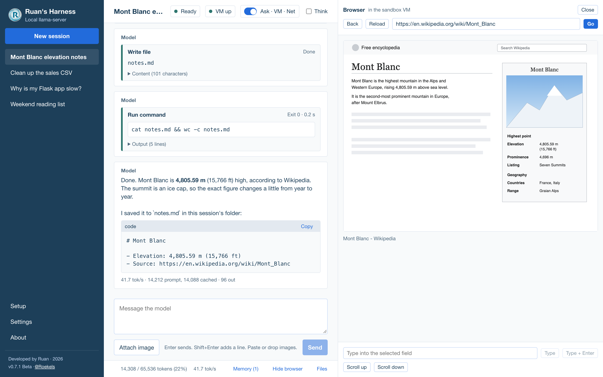
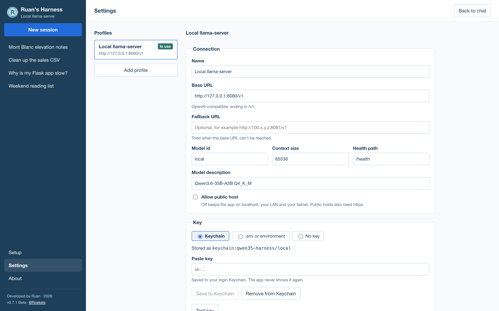
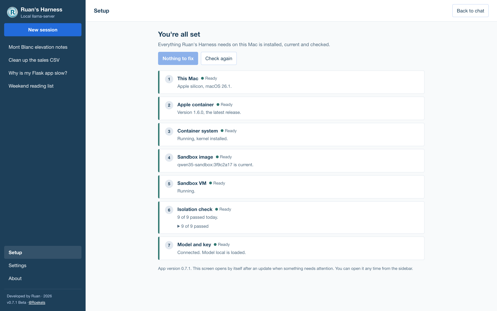
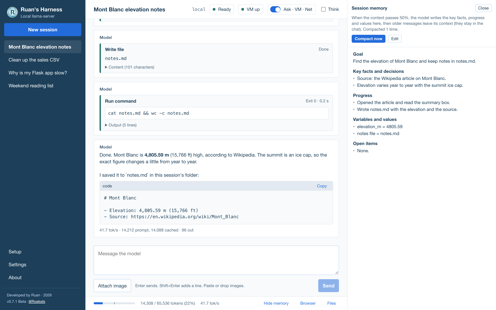
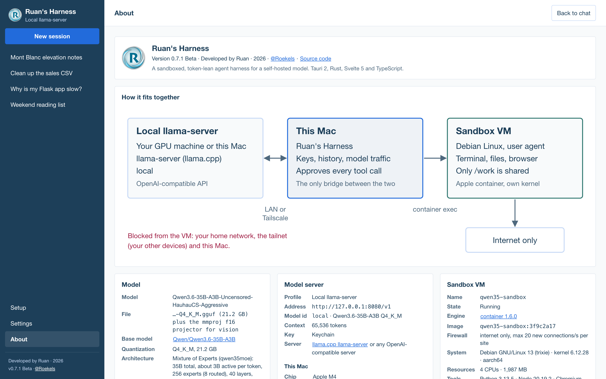

# Ruan's Harness

A small macOS app for working with a language model you host yourself. It gives the model a chat, saved sessions, and a terminal and browser that run in an isolated Linux VM on your Mac. It is built to spend as few tokens as possible, so a local model stays fast.

It was tuned for Qwen3.6-35B-A3B on llama.cpp's `llama-server`, but it works with any OpenAI-compatible server on your own network (llama.cpp, Ollama, LM Studio, vLLM).



Status: **0.7.1 Beta**. macOS on Apple silicon only.

## What it does

- **Chat** with streaming replies, a Think toggle, images (paste, drop or attach), and live token and speed numbers.
- **Sessions** saved on your Mac, with automatic titles.
- **Tools**: the model can run commands, read and write files, and use a headless browser (pages as text, clicks, typing, screenshots, network requests, console). Each command asks for your approval unless you turn on auto-approve.
- **Sandbox**: tools run in a Linux VM made with Apple's `container` tool. The VM sees only a work folder, never your Mac. Its firewall allows the internet (or nothing) but blocks your home network, Tailscale and the Mac itself. A built-in self-test proves it.
- **Lean on tokens**: a fixed prompt start so llama.cpp can reuse its cache, clipped tool output, and automatic compaction with a session memory when a chat passes half the context window.
- **Keys** stay in the macOS Keychain. The UI never sees them.
- **Setup assistant** that installs or upgrades Apple `container` (signature checked), builds the sandbox and runs the isolation check.

## How it fits together

```
Your model server  <--- your network (LAN, Tailscale, localhost) --->  Ruan's Harness on your Mac
(llama-server etc.)                                                     keys, history, model traffic
                                                                               |
                                                                        container exec
                                                                               |
                                                                        Linux VM "qwen35-sandbox"
                                                                        terminal, files, browser
                                                                        internet only, or no network
```

Only the app talks to the model. The VM never sees a key and can't reach your network.

## Get started

The full step by step guide, for you or your coding agent, is in **[docs/getting-started.md](docs/getting-started.md)**. Short version:

1. Run an OpenAI-compatible model server you can reach from your Mac (for example `llama-server --jinja --alias local`).
2. Install Node 22, Rust and the Xcode Command Line Tools.
3. Clone and run:

   ```bash
   git clone https://github.com/roekels/private-llm-harness.git
   cd private-llm-harness
   npm install
   npm run tauri dev
   ```

4. In the app, open **Settings**, point the profile at your server, and select **Test connection**.
5. Open **Setup** and select **Set up everything** to install the sandbox (needs macOS 26 or newer).

## Requirements

| Need | Why |
| --- | --- |
| Mac with Apple silicon | Apple `container` runs only on Apple silicon |
| macOS 26 or newer | For the sandbox VM. Chat alone runs on macOS 13 or newer |
| Node 22 and npm | Builds the UI |
| Rust (stable) and Xcode Command Line Tools | Builds the app |
| A model server | Any OpenAI-compatible API on localhost, your LAN or a VPN such as Tailscale |
| About 3 GB free disk | Sandbox image with Chromium, plus build files |

## Screenshots

| | |
| --- | --- |
|  |  |
| Settings: connection profile and key | Setup: install and check the sandbox |
|  |  |
| Session memory after compaction | About: the model, server, Mac and VM |

## Docs

| File | What |
| --- | --- |
| [docs/getting-started.md](docs/getting-started.md) | Install, connect your model, set up the sandbox |
| [docs/architecture.md](docs/architecture.md) | How the app, model and VM work together; the token budget |
| [docs/security.md](docs/security.md) | What the sandbox blocks, how keys are kept, the threat model |
| [docs/development.md](docs/development.md) | Build, test, CLI examples, release |
| [docs/roadmap.md](docs/roadmap.md) | What is done and what is next |
| [AGENTS.md](AGENTS.md) | Rules for coding agents working on this repo |

## License

MIT. See [LICENSE](LICENSE).

Not affiliated with Apple, Alibaba (Qwen) or the llama.cpp project.
